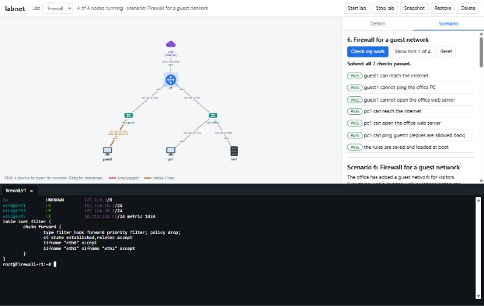

# labnet

**A network lab on one machine.** Describe a network of PCs, switches,
routers and servers in a short file; labnet builds it out of Linux
containers; you log in to the devices and configure them yourself:
addressing, routing, NAT, DHCP, DNS, firewalls, VLANs, OSPF. Guided scenarios
tell you whether you got it right.



Nothing in a lab is configured for you. A PC has no address until you run a
DHCP server; a router forwards nothing useful until you give it addresses;
the internet is unreachable until you write the NAT rule. That is the point:
it is a place to practise real network administration, break things, and
find out why.

## Quick start

On Debian or Ubuntu (on Windows: inside WSL2, see [docs/install.md](docs/install.md)):

```bash
git clone <repository-url> labnet && cd labnet
./install.sh                         # installs Incus if needed, then labnet
labnet up examples/office.yaml       # build a lab (the first run takes ~2 minutes)
labnet web                           # open http://localhost:8080
```

Click the router in the picture to get a console on it. Or stay in the
terminal:

```console
$ labnet list
Lab office: 5 of 5 node(s) running
  NODE  ROLE    STATE    IFACE  NETWORK     LINK  IPv4 ADDRESS
  r1    router  running  eth0   lan-office  up    -
                         eth1   lan-guest   up    -
                         eth2   wan         up    -
  srv1  server  running  eth0   lan-office  up    -
  pc01  pc      running  eth0   lan-office  up    -
  ...
$ labnet shell r1
root@office-r1:~# ip address add 192.168.10.1/24 dev eth0
```

Or let a scenario guide you:

```console
$ labnet scenario start nat
...
$ labnet scenario check
Checking scenario 'nat' (7 checks)
  PASS  r1 has an address on its WAN interface (eth1)
  PASS  r1 itself can reach the internet
  FAIL  r1 has a source NAT rule
        Found: the expected text is not in the output: (no output)
        Without NAT the PCs' private addresses leave the router unchanged and replies never return.
  ...
```

## A lab is a few lines of YAML

```yaml
name: office
networks:
  lan-office: {}                 # a switch
  lan-guest: {}                  # another switch
  wan: {uplink: true}            # the way out to the real internet
nodes:
  r1:   {role: router, links: [lan-office, lan-guest, wan]}
  srv1: {role: server, links: [lan-office]}
  pc:   {role: pc, links: [lan-office], count: 3}
```

## What it does

- **Builds labs from a topology file**, safely repeatable, and waits until
  every node has really finished booting.
- **Consoles that cannot be locked out.** `labnet shell` and the browser
  terminal go straight from the host into the node, so they still work after
  you break the node's network.
- **Three kinds of node**, all Debian 13 with the tools already installed:
  PCs (DHCP clients), routers (nftables, FRR, dnsmasq) and servers (Kea,
  BIND 9, dnsmasq, nginx). Services are installed but switched off.
- **Real internet uplink** for NAT exercises, and **VLANs** with access and
  trunk ports.
- **Break things on purpose:** pull a cable (`labnet link down r1 wan`), add
  delay and packet loss, capture packets to the screen or a Wireshark file.
- **Snapshots:** save a lab's state and return to it.
- **Eight guided scenarios** with automatic checking, hints, and written
  reference solutions.
- **A web UI** with a live topology picture, consoles in the browser, and
  the scenarios. It listens on your own machine only.
- **Ansible inventory export** that works on nodes without any address.
- **Keeps to itself.** It only ever touches Incus objects it created and
  marked, asks before deleting, and never auto-starts labs.

## Scenarios

| # | Scenario | What you practise |
|---|----------|-------------------|
| 1 | `static` | Static addresses; two PCs on one switch |
| 2 | `routing` | One router, two networks, default gateways |
| 3 | `dhcp` | Running a DHCP server |
| 4 | `nat` | A router's uplink and source NAT with nftables |
| 5 | `dns` | An authoritative DNS zone and client resolver settings |
| 6 | `firewall` | A stateful firewall that keeps a guest network out of the office |
| 7 | `ospf` | OSPF on three routers, then pulling a cable and watching it reroute |
| 8 | `troubleshoot` | "The internet is down": five independent faults to find and fix |

Every reference solution in [docs/solutions/](docs/solutions/) is run by the
test suite against its scenario's checks, and again after restarting the
lab, so the documented answer is known to work and to survive a reboot.

## How it works

Each node is an [Incus](https://linuxcontainers.org/incus/) system container.
Each switch is a Linux bridge with no address, DHCP or DNS. The uplink is a
bridge where Incus plays the internet provider. labnet is about 3,600 lines
of plain, commented Python that turn the topology into those objects and
operate them, including a small FastAPI backend, plus a web page written
without a framework or a build step.

```
topology.yaml --> validate --> plan --> Incus networks + containers --> wait until booted
                                              ^
          CLI and web UI call one engine -----+----- scenarios: setup scripts and checks
```

More in [docs/architecture.md](docs/architecture.md), and the reasons behind
the choices in [docs/design-decisions.md](docs/design-decisions.md).

## Documentation

| | |
|---|---|
| [Install](docs/install.md) | Windows 11 with WSL2 from zero; Debian and Ubuntu |
| [User guide](docs/user-guide.md) | Every command, the topology file reference, how device access works |
| [Scenarios](docs/scenarios.md) | Running them, and writing your own without any Python |
| [Reference solutions](docs/solutions/) | Worked answers with explanations |
| [Architecture](docs/architecture.md) | The modules, and how a topology becomes Incus objects |
| [Design decisions](docs/design-decisions.md) | What was tested before building, what was chosen and what was rejected |
| [Troubleshooting](docs/troubleshooting.md) | Problems actually met, with fixes |
| [Limitations](docs/limitations.md) | What it does not do |
| [Changelog](CHANGELOG.md) · [Project log](PROJECT_LOG.md) | History of the build |

## Honest limits

- Routers and switches are **Linux**. You learn networking concepts and
  Linux tooling, not Cisco IOS commands.
- Developed and tested on **Debian 13 under WSL2**; other hosts are expected
  to work but were not all tested. See [install.md](docs/install.md).
- No Windows nodes, no drag-and-drop editor, IPv4 only in the scenarios.

The full list is in [docs/limitations.md](docs/limitations.md).

## Development

```bash
./dev.sh setup          # virtualenv with an editable install
./dev.sh test           # unit tests; no Incus needed
./dev.sh integration    # integration tests; builds and deletes real labs
./dev.sh lint           # ruff
```

The unit tests cover parsing, validation, planning, check evaluation and the
web backend without touching Incus. The integration tests build real labs
and exercise every command and every scenario.

## License

MIT. See [LICENSE](LICENSE).

`legacy/lab.sh` is the bash prototype this project grew out of.
