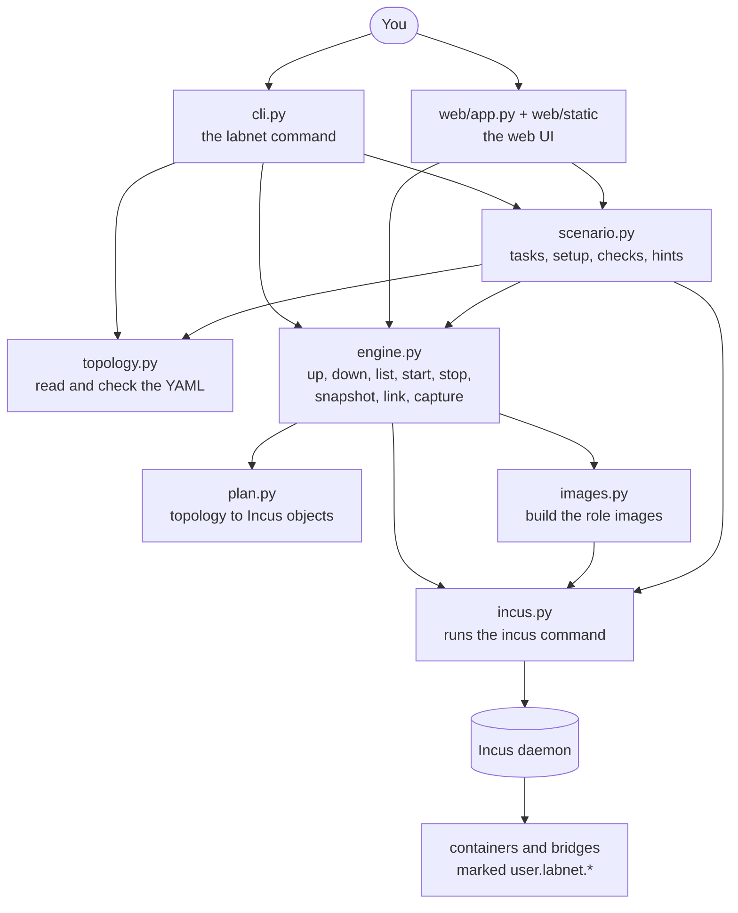

# Architecture

labnet is a thin layer over [Incus](https://linuxcontainers.org/incus/). It
adds three things: a topology file format, a set of pre-built node images,
and tooling around the resulting lab (links, captures, scenarios, a web UI).

## The pieces



| Module | Job | Talks to Incus? |
|--------|-----|-----------------|
| `topology.py` | Parse the YAML, validate it, report every problem with file and node names. Produces `Topology`, `Network`, `Node`. | no |
| `plan.py` | Pure function from a `Topology` to the exact Incus networks and containers that realise it. | no |
| `incus.py` | The only place that runs the `incus` command. Turns failures into readable errors. | yes |
| `images.py` | The recipe for the PC, router and server images, and the build procedure. | via `incus.py` |
| `engine.py` | Every operation on a lab. Works out what belongs to a lab from markers on Incus objects. | via `incus.py` |
| `scenario.py` | Loads scenarios, runs setup scripts, evaluates checks. | via `engine.py`, `incus.py` |
| `hostcheck.py` | `install-check`: read-only checks of the host. | read-only |
| `ansible_export.py` | Formats an inventory from a lab's state. | no |
| `cli.py` | Parses arguments, calls the modules above, prints. No lab logic. | no |
| `web/app.py` | HTTP and WebSocket endpoints that call the same engine functions. No lab logic. | no |
| `web/terminal.py` | A pseudo-terminal wrapped around `incus exec` for browser consoles. | runs `incus exec` |
| `web/static/` | The page: plain HTML, CSS and JavaScript, plus vendored libraries. | no |

The CLI and the web UI are two front ends to one engine. Neither contains
logic the other lacks; anything the page can do is one engine call that the
CLI can make too.

## How a topology becomes Incus objects

Take this file:

```yaml
name: office
networks:
  lan-office: {}
  wan: {uplink: true}
nodes:
  r1:   {role: router, links: [lan-office, wan]}
  pc01: {role: pc, links: [lan-office]}
```

`labnet up` turns it into the following (the hex digits in the bridge names
are illustrative):

```
Incus network  ln-3f9c2a71   (Linux bridge)          <- lan-office
    ipv4.address = none          no address on the host side,
    ipv6.address = none          so Incus runs no DHCP, DNS or NAT on it
    user.labnet.managed = true
    user.labnet.lab = office
    user.labnet.network = lan-office
    user.labnet.kind = segment

Incus network  ln-b07d4e15   (Linux bridge)          <- wan
    ipv4.address = auto          Incus owns the gateway address,
    ipv4.nat = true              serves DHCP and DNS, and NATs outwards
    ipv6.address = none
    user.labnet.kind = uplink    (plus the same lab markers)

Incus container  office-r1   from image labnet-router
    limits.memory = 384MiB, limits.cpu = 1
    boot.autostart = false
    user.labnet.managed = true
    user.labnet.lab = office
    user.labnet.node = r1
    user.labnet.role = router
    user.labnet.links = lan-office,wan
    devices:
        root  disk  on the default storage pool
        eth0  nic   on ln-3f9c2a71      (first link)
        eth1  nic   on ln-b07d4e15      (second link)

Incus container  office-pc01  from image labnet-pc
    ...
    devices: root, eth0 on ln-3f9c2a71
```

The steps `up` takes, in order:

1. **Validate** the file (`topology.py`). Nothing is created if it has errors.
2. **Plan** (`plan.py`): compute the objects above. No Incus calls yet.
3. **Check for clashes**: if any needed name is already used by an object
   that does not carry this lab's marker, stop before changing anything.
4. **Ensure images**: build `labnet-pc`, `labnet-router`, `labnet-server` if
   a needed one is missing.
5. **Create** the networks, then the containers, skipping those that exist.
6. **Start** everything that is not running.
7. **Wait** until `systemctl is-system-running` in every container says the
   boot is complete.

### Why the bridges have odd names

Linux interface names are limited to 15 characters, and `office-lan-office`
is already 17. Each bridge is therefore named `ln-` plus the first 8 hex
digits of the SHA-1 hash of `<lab>/<network>`. The name is short, unique in
practice, and the same every time, which is what lets `up` be repeated. You
never need to type it: every command takes the readable network name, and
the bridge's description and config keys record what it is.

### How labnet knows what it owns

Not by name. Every object it creates carries `user.labnet.managed=true` and
the lab's name. `labnet list`, `down`, `start`, `stop` and the rest call one
function, `engine.read_labs()`, which lists all Incus instances and networks
and keeps only those with the marker. An object without it is invisible to
labnet and can never be deleted by it.

## The node images

A node is a copy of one of three local images, built once by `images.py`:

1. Create a temporary NAT network and a container from `images:debian/13`.
2. Run a shell script in it: install the packages for the role, disable the
   installed services, write the role's default network configuration, set
   IPv4 forwarding on (routers) or off (everything else).
3. Remove what must not be shared between nodes: SSH host keys (a small unit
   regenerates them on first boot) and the machine ID.
4. Stop the container, publish it as `labnet-<role>`, delete the temporary
   container and network.

The recipe is data at the top of `images.py` (package lists, services to
disable) plus one function that renders the shell script.

## Consoles

```
labnet shell r1            ->  incus exec office-r1 -- bash -l

browser tab (xterm.js)  <--WebSocket-->  web/app.py  <--PTY-->  incus exec office-r1 -- bash -l
```

Both run the same command. `incus exec` enters the container from the host
through the Incus daemon, without using any lab network. For the browser,
the backend starts that command on a pseudo-terminal so that the shell
behaves like a real terminal (colours, line editing, `nano`, `vtysh`), and
copies bytes between the PTY and a WebSocket.

## Scenarios

A scenario is a directory (see [scenarios.md](scenarios.md)). `scenario
start` calls `engine.up` with the scenario's topology, tagging every object
with `user.labnet.scenario`, then pipes each `setup/*.sh` script into its
node. `scenario check` runs each check's command in the named node through
`incus exec` and compares the result with what the YAML expects.

## Where state lives

labnet keeps **no state files of its own**. Which labs exist, what is in
them, and which scenario a lab belongs to are all read from Incus every
time. If you delete a lab's containers with `incus delete`, labnet simply
no longer sees them. The only things outside Incus are the browser's saved
diagram positions.
