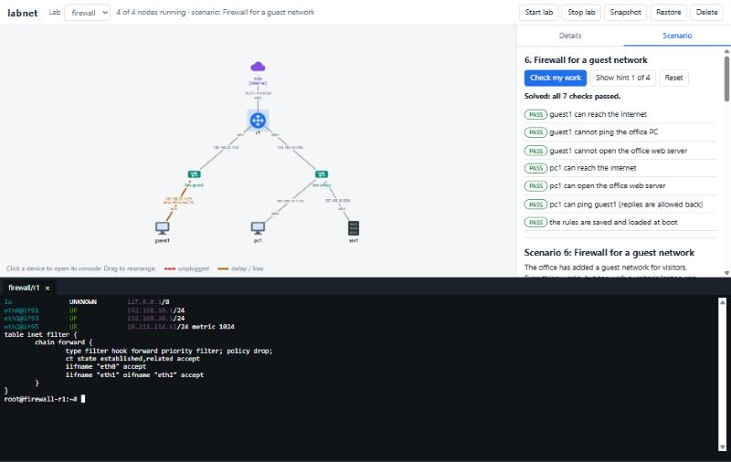

# User guide

- [The idea](#the-idea)
- [Topology files](#topology-files)
- [Commands](#commands)
- [How device access works](#how-device-access-works)
- [Configuring a node so that it survives a reboot](#configuring-a-node-so-that-it-survives-a-reboot)
- [The web UI](#the-web-ui)
- [Using Ansible](#using-ansible)

## The idea

You write a short file that says which devices exist and what they are
plugged into. labnet builds that as a **lab**: every device is a small Linux
system (an Incus container) and every switch is a Linux bridge. Then you log
in to the devices and configure them yourself. Nothing is configured for
you, because configuring it is the point.

| In the lab | What it really is | How it starts |
|------------|-------------------|---------------|
| **PC** | container from the `labnet-pc` image | Asks for an address by DHCP on every interface. No DHCP server on the network means no address. |
| **Router** | container from the `labnet-router` image | Forwards IPv4 packets. Interfaces have no addresses. nftables, FRR and dnsmasq are installed but not running. |
| **Server** | container from the `labnet-server` image | Interfaces have no addresses. dnsmasq, Kea DHCP, BIND 9, nginx and nftables are installed but not running. |
| **Switch** (a network) | a Linux bridge with no address | Passes Ethernet frames between whatever is plugged in. No DHCP, DNS or routing. |
| **Uplink** (a network with `uplink: true`) | a Linux bridge where Incus acts as the internet provider | Hands out addresses by DHCP, answers DNS, and NATs to the real internet. |

All nodes run Debian 13 and include the usual tools: `ip`, `ping`,
`traceroute`, `mtr`, `tcpdump`, `dig`, `curl`, `nc`, `iperf3`, `nft`,
`ssh`/`sshd`, `nano`, `vim`.

## Topology files

A topology is a YAML file with three parts.

```yaml
name: office                # the lab's name

networks:
  lan-office: {}            # a switch
  lan-guest: {}             # another switch
  wan: {uplink: true}       # the way out to the internet

nodes:
  r1:   {role: router, links: [lan-office, lan-guest, wan]}
  srv1: {role: server, links: [lan-office]}
  pc:   {role: pc, links: [lan-office], count: 3}     # pc01, pc02, pc03
  pc09: {role: pc, links: [lan-guest], memory: 512MiB, cpu: 2}
```

### `name`

Lowercase letters, digits and hyphens, starting with a letter, at most 20
characters. Containers are called `<lab>-<node>`, for example `office-r1`,
and that is also the hostname you see in the prompt.

### `networks`

| Setting | Meaning |
|---------|---------|
| *(none)*, written `{}` | A plain switch. |
| `uplink: true` | A network with a gateway that provides DHCP, DNS and NAT to the real internet. Plug a router's WAN side into it. |
| `subnet: 198.51.100.0/24` | Only with `uplink: true`. The address range of the uplink; the gateway takes the first address. Without it Incus picks an unused private range. |

A plain switch cannot have a `subnet`: which addresses are used on it is up
to you, inside the lab.

### `nodes`

| Setting | Meaning |
|---------|---------|
| `role` | `pc`, `router` or `server`. Required. |
| `links` | The networks the node is plugged into. Required. **The order sets the interface names:** the first link is `eth0`, the second `eth1`, and so on. |
| `count` | Make this many copies, named with a two-digit suffix: `pc` with `count: 3` gives `pc01`, `pc02`, `pc03`. |
| `memory` | Memory limit, such as `256MiB` or `1GiB`. Defaults: PC 256MiB, router 384MiB, server 512MiB. |
| `cpu` | Number of CPUs. Default 1. |
| `image` | Use a different Incus image instead of the role image, for example `images:alpine/3.20`. Such a node gets none of the labnet tools; see [limitations](limitations.md). |

### VLANs

A link can also say how the **switch port** it plugs into is configured:

```yaml
nodes:
  r1:  {role: router, links: [{network: sw, trunk: [10, 20]}]}   # trunk port
  pc1: {role: pc, links: [{network: sw, vlan: 10}]}              # access port, VLAN 10
  pc2: {role: pc, links: [{network: sw, vlan: 20}]}              # access port, VLAN 20
  pc3: {role: pc, links: [sw]}                                   # plain port (VLAN 1)
```

- `vlan: N` is an access port: the device sends and receives ordinary
  untagged frames and is a member of VLAN N only.
- `trunk: [..]` is a trunk port: the listed VLANs arrive tagged (802.1Q).
  The device needs a sub-interface per VLAN, for example
  `ip link add link eth0 name eth0.10 type vlan id 10`.

Devices in different VLANs cannot reach each other through the switch even
if they use the same IP subnet. `examples/vlan.yaml` is a ready-made
"router on a stick" lab with instructions in its comments.

### Mistakes are explained

Every problem in the file is reported in one go, with the file, the node and
a suggestion:

```
Error: The topology file has 2 problems:
  office.yaml: node 'r1': link 'lan-ofice' is not a defined network (did you mean
  'lan-office'?); defined networks: lan-office, lan-guest, wan
  office.yaml: node 'pc1': unknown role 'desktop'; choose one of: pc, router, server
  What to do: Fix the file and run the command again. ...
```

## Commands

Run `labnet <command> --help` for the details of any command.

**Naming nodes.** Commands that take a node accept the short name (`r1`) as
long as only one lab has a node called that. Otherwise write `lab/node`
(`office/r1`); labnet tells you when it needs that.

### `labnet install-check`

Checks that this machine can run labs, and says how to fix what is missing.
See [install.md](install.md#checking-the-installation).

### `labnet up <file>`

Builds the lab described by a topology file and waits until every node has
finished booting.

```console
$ labnet up examples/office.yaml
Building lab 'office' from office.yaml
  network lan-office: creating switch
  network lan-guest: creating switch
  network wan: creating uplink (internet)
  node r1: creating router
  ...
  starting 5 node(s)
  waiting for every node to finish booting
Lab 'office' is ready: 5 node(s), 3 network(s).
```

It is safe to run again. Whatever exists is left alone, whatever is missing
is created, whatever is stopped is started. `up` never changes or deletes a
node: if a node no longer matches the file it says so, and you decide whether
to `down` the lab and rebuild.

The very first `up` builds the node images, which takes a couple of minutes
and needs internet access.

### `labnet list [lab]`

```console
$ labnet list
Lab office: 5 of 5 node(s) running
  NODE  ROLE    STATE    IFACE  NETWORK     LINK  IPv4 ADDRESS
  r1    router  running  eth0   lan-office  up    192.168.10.1/24
                         eth1   lan-guest   up    192.168.20.1/24
                         eth2   wan         up    10.229.7.189/24
  srv1  server  running  eth0   lan-office  up    192.168.10.2/24
  pc01  pc      running  eth0   lan-office  up    192.168.10.100/24
  ...
  Networks: lan-guest (switch); lan-office (switch); wan (uplink to the internet, gateway 10.229.7.1/24)
```

The LINK column shows `DOWN` for an unplugged cable and any delay or loss
set on the link.

### `labnet shell <node>`

Opens a root console on the node. Leave with `exit` or Ctrl+D.

```console
$ labnet shell r1
root@office-r1:~#
```

### `labnet exec <node> -- <command>`

Runs one command on a node and returns its exit code.

```bash
labnet exec pc01 -- ip -brief address
labnet exec r1 -- sh -c 'nft list ruleset | head'
```

### `labnet start <lab> [node]` and `labnet stop <lab> [node]`

Stop and start a whole lab or a single node. Stopping keeps everything on
disk; it is like switching the devices off. Labs are **not** started
automatically when the computer (or WSL) restarts, so after a restart:

```bash
labnet start office
```

### `labnet down <lab>`

Deletes the lab: its nodes, their disks and its networks. Asks for
confirmation unless you add `--yes`. It only ever removes objects that
labnet created for that lab.

### `labnet snapshot <lab> [name]` and `labnet restore <lab> [name]`

Save the state of every node, and go back to it later. The default name is
`snap`.

```bash
labnet snapshot office before-firewall
# ... experiment, break things ...
labnet restore office before-firewall
```

A snapshot holds the nodes' **files**. Restoring a running node restarts it,
like a power cycle: what is saved in configuration files comes back, what
was only set with commands (`ip addr add ...`) is gone. Taking a snapshot
with the same name again replaces the old one.

### `labnet link down|up <node> <network>`

Pull a node's network cable, and plug it back in.

```bash
labnet link down r1 wan
labnet link up r1 wan
```

### `labnet link set <node> <network> --delay <time> --loss <percent>`

Make a link slow or unreliable. `labnet link clear <node> <network>` removes
it again.

```bash
labnet link set r1 wan --delay 80ms --loss 2
ping 1.1.1.1            # on a PC: replies take 80 ms longer, some are lost
labnet link clear r1 wan
```

The delay and loss apply to packets the node **sends** on that link. To
affect both directions, set it on the nodes at both ends.

### `labnet capture <node> <network> [filter]`

Watch packets on a node's link with tcpdump. Stop with Ctrl+C.

```bash
labnet capture r1 wan icmp                      # print matching packets
labnet capture srv1 lan port 67 or port 68      # watch DHCP
labnet capture r1 wan -c 20 -w wan.pcap         # save 20 packets for Wireshark
```

`-c N` stops after N matching packets. If fewer than N ever arrive, it keeps
waiting until you press Ctrl+C.

### `labnet scenario ...`

Guided exercises with automatic checking. See [scenarios.md](scenarios.md).

```bash
labnet scenario list
labnet scenario start nat
labnet scenario check
labnet scenario hint
labnet scenario reset
```

### `labnet web`

Starts the web UI on <http://localhost:8080>. See [The web UI](#the-web-ui).

### `labnet export ansible <lab>`

Writes an Ansible inventory for the lab. See [Using Ansible](#using-ansible).

### `labnet images build|list|remove`

The node images are built automatically when first needed. These commands
are for looking at them and rebuilding them.

```bash
labnet images list
labnet images build --rebuild          # rebuild all three
labnet images build router --rebuild   # just one
```

Existing nodes are not affected by a rebuild; only nodes created afterwards
use the new image.

## How device access works

**The console is the way in.** `labnet shell`, `labnet exec` and the web
terminal enter a node directly from the host. They do not use the lab's
network, so they keep working when you have broken a node's addresses,
routes or firewall. You cannot lock yourself out of a node.

**You are root, and there is no password.** The console logs you in as
`root` without asking for anything. The `root` account has no password set,
which means nobody can log in as root *with* a password, over SSH or
otherwise. No other user accounts exist until you create them.

**SSH is there to practise with, between nodes.** Every node runs an SSH
server. To log in from one node to another, create a user with a password
on the target first:

```bash
# on srv1
adduser alice
# on pc01
ssh alice@192.168.10.2
```

or install a key for root (`ssh-keygen` on the client, then put the public
key in `/root/.ssh/authorized_keys` on the server; root may log in with a
key but not with a password).

**SSH host keys.** Each node generates its own host keys the first time it
boots. When you delete and rebuild a lab, the new nodes get new keys, and an
SSH client that remembers the old key refuses to connect ("REMOTE HOST
IDENTIFICATION HAS CHANGED"). That warning is SSH doing its job. Remove the
old entry with `ssh-keygen -R <address>` on the client and connect again.

## Configuring a node so that it survives a reboot

Commands such as `ip address add` change the running system only. Lab nodes
do restart: when you stop and start a lab, when you restore a snapshot, and
on WSL whenever Windows shuts WSL down. Put what should last in files.

**Addresses, gateway, DNS** are handled by `systemd-networkd`, which reads
`/etc/systemd/network/*.network`:

```ini
# /etc/systemd/network/10-lan.network
[Match]
Name=eth0

[Network]
Address=192.168.10.1/24
Gateway=192.168.10.254        # optional
DNS=192.168.10.2              # optional
```

Apply with `networkctl reload`. For a DHCP client use `DHCP=ipv4` instead of
`Address=`. Files are read in name order and the first one that matches an
interface wins. PCs ship with `10-labnet-dhcp.network` (DHCP on everything),
so a static file on a PC needs a name that sorts earlier, such as
`05-static.network`.

**Kernel settings** such as forwarding: a file in `/etc/sysctl.d/`, for
example `net.ipv4.ip_forward = 1`. (Routers already have this.)

**Firewall and NAT rules**: `/etc/nftables.conf`, loaded at boot once you run
`systemctl enable nftables`. Load it now with `nft -f /etc/nftables.conf`.

**Services**: `systemctl enable --now <service>` starts a service and makes
it start at every boot.

The [reference solutions](solutions/) show all of these in context.

## The web UI

```bash
labnet web
```

then open <http://localhost:8080> (on WSL: in your Windows browser).



- **The picture** shows the lab: devices, switches, the internet uplink, and
  each cable with its interface name and address. An unplugged cable is red
  and dashed; a cable with delay or loss is orange. Drag devices to
  rearrange them; the arrangement is remembered by your browser.
- **Click a device** to open its console in a tab at the bottom and to see
  its controls on the right: start or stop it, unplug each cable, set delay
  and loss.
- **Click a switch** to see what is plugged into it.
- **The buttons at the top** start, stop, snapshot, restore or delete the
  whole lab.
- **The Scenario tab** lists the guided scenarios, starts them, shows the
  task, checks your work and reveals hints.

The page refreshes every few seconds, so changes made in a terminal appear
too. Link to a specific view with, for example,
`http://localhost:8080/#lab=office&node=r1`.

### Security of the web UI

The web UI has **no login**, and its consoles are root shells on your lab
nodes. For that reason:

- It listens on `127.0.0.1` only. Other computers cannot reach it.
- It refuses requests that do not come from its own page, so another website
  open in your browser cannot use it behind your back.

`labnet web --host <address>` makes it reachable from the network, where
`<address>` is one specific address of this machine (`0.0.0.0` is refused).
Do not do that on a network you do not fully control: anyone who can reach
the address gets root on every lab node. labnet prints a warning and asks
you to confirm. This mode was not tested from a second machine.

## Using Ansible

```bash
labnet export ansible office            # writes inventory-office.ini
ansible -i inventory-office.ini all -m ping
ansible -i inventory-office.ini routers -a "ip -brief address"
```

The inventory groups nodes as `routers`, `servers` and `pcs`. It connects
through Incus instead of SSH (Ansible's `community.general.incus` connection
plugin, included in Debian's and Ubuntu's `ansible` package), so playbooks
work even on nodes that have no address yet, and there are no SSH keys to
manage. Run Ansible on the same machine as labnet.
